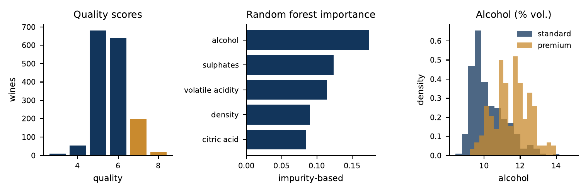
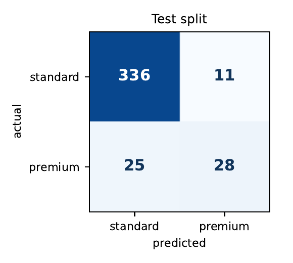

# wine-wandb

Red wine quality with [Weights & Biases](https://wandb.ai) experiment tracking.
A small but complete project used in the course *Data-driven Systems Engineering* (440MI / 305SM):
a reproducible baseline, a hyperparameter sweep, versioned model artifacts, and a Registry
promotion.

## One dataset, two tasks

The UCI *Wine Quality* file (red wine, 1,599 samples, 11 physicochemical features) supports two
framings of the same problem. Both are tracked, versioned, and registered the same way.

| | Task 1: regression | Task 2: premium classification |
|---|---|---|
| Question | What is the quality score? | Is the wine premium (quality >= 7)? |
| Target | `quality` (3 to 8) | `quality >= 7` (217 wines, 13.6%) |
| Model | `GradientBoostingRegressor` | `RandomForestClassifier` (300 trees) |
| Selection metric | cross-validated R2 (`KFold`) | cross-validated F1 (`StratifiedKFold`) |
| Decision | none: the output is a number | the predicted class (`predict`) |
| Tracked run | `train.py`, `sweep.py` | `train_classifier.py` |
| Artifact | `wine-pipeline` (`pipeline.joblib`) | `wine-premium` (`pipeline.joblib`) |
| Used in class for | tracking, sweeps, registry | evaluation and the decision-support example |

Both tasks share the data module, the fixed 75/25 split, and the seed.

## The activity

The goal is not to build the best wine model, but to practice the workflow around a model so
that every result can be traced and reproduced. Starting from the same dataset, you:

1. fit a **baseline** and log it to W&B (hyperparameters, cross-validated metrics, timing, dataset SHA-256, Git commit);
2. run a **hyperparameter sweep** and compare runs in the dashboard, using the mean and standard deviation of the CV score;
3. save the full pipeline (scaler + model) as a **versioned artifact**;
4. pick a version using **cross-validation only**, score it **once** on the held-out test split, and, if approved, **promote** it in the W&B Registry (rolling back means moving the alias).

Task 2 adds a decision on top of the score: a wine is flagged as premium when the model predicts
class 1. Because only 13.6% of the wines are premium, accuracy alone is misleading (always
answering "standard" already gets 86.7% on the test split), so the evaluation looks at
precision, recall, F1, and the AUCs as well.

## Results (task 2, test split)

Random forest (300 trees) trained on 1,199 wines and scored once on the 400 held-out wines
(53 of them premium). Reproduce with `make figures`.



- Premium wines (gold) are the minority: scores 7 and 8 make up 217 of 1,599 wines.
- Alcohol is the most important feature (0.17), followed by sulphates, volatile acidity, density, and citric acid.
- Premium wines have a higher median alcohol content (11.6% vs 10.0% vol.).



| Metric | Value |
|---|---|
| Accuracy | 0.910 (majority-class baseline: 0.867) |
| Precision | 0.718 |
| Recall | 0.528 |
| F1 | 0.609 |
| ROC-AUC | 0.939 |
| PR-AUC | 0.753 |

The model ranks wines well (ROC-AUC 0.94) but, at the default 0.5 threshold, it is cautious:
28 of 53 premium wines are found (recall 0.53), with 11 false alarms, and 25 premium wines are missed.
Whether that trade-off is acceptable depends on the cost of each kind of error, which is the point
of the decision-support example used in class.

## Quick start

```bash
python -m venv .venv && source .venv/bin/activate
make install
wandb login            # once; not needed for the tests
make data              # downloads the UCI CSV into data/
make train             # task 1: baseline run
make sweep             # task 1: 81-configuration grid search
make train-classifier  # task 2: premium classifier run
make evaluate ARTIFACT=wine-pipeline:v0           # task 1, test split, once
make evaluate-premium ARTIFACT=wine-premium:v0    # task 2, test split, once
make figures           # dataset overview and confusion matrix; writes reports/
make test              # no network or account required
```

## Layout

| Path | Purpose |
|---|---|
| `configs/baseline.yaml` | Task 1: seed, split, CV folds, default hyperparameters |
| `configs/sweep.yaml` | Task 1: W&B sweep, 3 x 3 x 3 x 3 grid, metric `cv/r2_mean` |
| `configs/classifier.yaml` | Task 2: seed, split, CV folds, number of trees |
| `src/wine_wandb/data.py` | Download, checksum, load, fixed train/test split |
| `src/wine_wandb/pipeline.py` | Task 1: `StandardScaler` + `GradientBoostingRegressor` as one `Pipeline` |
| `src/wine_wandb/premium.py` | Task 2: label, classifier pipeline, classification metrics |
| `src/wine_wandb/train.py` | Task 1: one tracked run (CV score, timing, pipeline artifact) |
| `src/wine_wandb/train_classifier.py` | Task 2: one tracked run (cross-validated F1, precision, recall, ROC-AUC; pipeline artifact) |
| `src/wine_wandb/sweep.py` | Creates a sweep and runs an agent that calls `train.run` |
| `src/wine_wandb/evaluate.py` | Scores an artifact on the untouched test split (`--task regression` or `premium`) |
| `src/wine_wandb/register.py` | Links an approved artifact version to a Registry collection |
| `src/wine_wandb/figures.py` | Figures and numbers for the slides: dataset overview and test confusion matrix |
| `docs/figures/` | PNG copies of the figures shown in this README (`reports/` is git-ignored) |
| `tests/` | Unit tests and smoke tests (`WANDB_MODE=disabled`) |

## The four checkpoints

1. **Baseline:** `make train` (or `make train-classifier`) with the fixed split and seed.
2. **Compare:** `make sweep`; compare runs in the W&B dashboard (mean and standard deviation of the CV R2).
3. **Version:** every run logs the full pipeline (preprocessing + model) as an artifact, together with the dataset SHA-256 and, automatically, the Git commit.
4. **Approve:** choose a version using cross-validation only, run the matching `evaluate` target once on the test split, then link it to the Registry, for example
   `python -m wine_wandb.register --artifact wine-premium:v0 --collection wandb-registry-model/wine-premium`.
   Rolling back means moving the alias to the previous version.

The test split is read only by `evaluate.py` and `figures.py`. Model selection uses cross-validation on the training split.

## Relation to the course

This repository is kept separate from the course repository (440MI). Clone it on its own and
follow the quick start above. Because W&B records the commit of the repository where the script
runs, every run points to a commit of this project alone.

## Data

UCI Machine Learning Repository, *Wine Quality* (red, 1,599 samples, 11 physicochemical features, target `quality`).
P. Cortez, A. Cerdeira, F. Almeida, T. Matos, J. Reis (2009). Modeling wine preferences by data mining
from physicochemical properties. *Decision Support Systems*, 47(4), 547-553.
Check the license on the dataset page before redistributing the file; it is not committed here.
